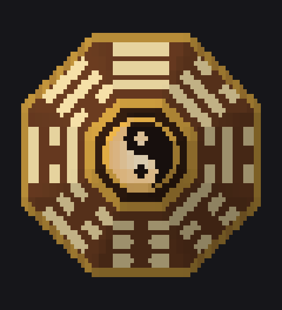

# mini-hakkero-spinner



A terminal spinner PoC: Marisa's Mini-Hakkero, spinning.

Each frame is shaded per pixel from vector geometry and printed with block glyphs, so one text cell carries a grid of subpixels — the lit ones in the foreground color, the rest in the background. Two colors per cell is the hard limit the terminal gives us.

```sh
go install github.com/aaronjauregui/mini-hakkero-spinner@latest
```

From a clone:

```sh
go run .                       # auto: sixel if the terminal has it, else sextants
go run . -render sextants      # 2x3 subpixels per cell
go run . -render half          # 1x2, for terminals with poor glyph coverage
go run . -render sixel         # real pixels
go run . -size 52              # width in cells; height follows, keeping it square
go run . "loading danmaku"     # custom caption
```

Press any key to quit.

## What's drawn

Outside in: the brass rim of the octagonal shell, the eight trigrams engraved
one per face, the inner octagon, and the master spark outlet — a yin-yang, its
dividing S built from two half circles of radius r/2, each lobe carrying an eye
of the opposite color, the yang half pulsing.

The trigrams are in the **Fu Xi (Earlier Heaven) arrangement**, clockwise from
the top face: ☰ Qian, ☴ Xun, ☵ Kan, ☶ Gen, ☷ Kun, ☳ Zhen, ☲ Li, ☱ Dui. That's
the arrangement where every trigram faces its own complement — opposite faces
sum to 7, so ☰ 111 sits across from ☷ 000 — which `TestBaguaArrangement`
checks. Each trigram is read from the center outwards, as on a bagua: its
bottom line is the bar nearest the outlet. `TestEngravingReadsBack` scans the
rendered geometry across each bar and reconstructs the three bits, so the test
covers what is actually drawn rather than the bit table.

## Sharpness

Everything is tuned to read at 36x18 cells, where a pixel is a big unit and
blending across it turns detail to mush:

- Each subpixel resolves to a single **material** by a majority vote over its
  3x3 samples, ties going to the finer detail, so boundaries stay hard and thin
  engraving never dissolves into the wood.
- Each cell then clusters its subpixels into two colors, again keyed on
  material: the two most common win, and any others join whichever they
  resemble. Empty subpixels always land in the unset background, so no dark box
  forms around the silhouette.
- The shell is lit one flat tone per face rather than by a smooth gradient —
  eight crisp facets, with the highlight fixed in screen space so it sweeps
  around as the furnace turns under it.

The shell is a signed-distance function (max over its eight face half-planes),
and samples are counter-rotated to spin it.

## Sixel

With real pixels there is no two-colors-per-cell limit, so the sixel path skips
the material vote entirely and just averages its samples.

At startup the terminal is asked what it can do — `CSI 16 t` for the pixel size
of a character cell, `CSI c` for its device attributes, whose reply lists `4`
when it can draw sixels — and `-render auto` picks accordingly. That
conversation happens on `/dev/tty`, not stdin: Go will not poll stdin, so a
read deadline there fails outright and a terminal that ignores the queries
would hang us forever, and stdin belongs to Bubble Tea, which runs its own
startup handshake we must not eat. The probe gives up after 250ms.

Bubble Tea v1 has no graphics support, so the image has to survive a renderer
that measures every line and truncates it to the terminal width. It does: a
sixel payload is a DCS sequence, which `ansi.StringWidth` measures as zero
cells, so truncation leaves it alone. The frame occupies `cellsH` lines, of
which the first are blank and the last carries the payload, wrapped in save
cursor / cursor up / restore cursor. Drawing from the *last* line matters —
Bubble Tea paints top to bottom, so an image emitted from the first line would
be erased by the blank lines that follow it in the same flush.

Two caveats. The encoder has no transparency, so the ground outside the
furnace is painted rather than left to show the terminal through. And a frame
is ~67 KB at the default size, against ~25 KB for sextants.

**This is unverified against a real sixel terminal** — GNOME Terminal 3.52 /
VTE 0.76 on Ubuntu is built with `-Dsixel=false` (the library ships the
`vte_terminal_set_enable_sixel` API and nothing behind it, and
`gnome-terminal --version` reports `+BIDI +GNUTLS +ICU +SYSTEMD` with no
`+SIXEL`). What *is* verified: `TestSixelRoundTrip` decodes the payload back to
an image and compares it pixel by pixel to the source, and `TestParseProbe`
covers the capability replies of terminals that do support it. The round trip
uses a decoder written in the test — x/ansi v0.10.1's own `sixel.Decoder`
returns a mostly-empty image for payloads that ImageMagick reads correctly.
The whole program has also been run under a pty against a simulated terminal
that answers the capability queries, which confirms it emits 20 sixel frames a
second, each one blank lines, save cursor, cursor up, the DCS payload, restore
cursor — and that it falls back to sextants when the pretend terminal answers
without attribute 4.

Try it in foot, WezTerm, mlterm, contour, Konsole or xterm built with sixel.

Built with [Bubble Tea](https://github.com/charmbracelet/bubbletea) (frame loop)
and [Lip Gloss](https://github.com/charmbracelet/lipgloss) (color, degraded
automatically on terminals without truecolor, plus caption layout).

- `hakkero.go` — geometry, materials, the bagua table
- `raster.go` — glyph sets and the subpixel rasterizer (`Render(t, glyphs)`)
- `sixel.go` — the terminal probe and the pixel renderer
- `main.go` — Bubble Tea model driving the rotation at 20fps

## Cost

Per frame at the default size, on a machine where a full turn is 80 frames:
sextants 1.1ms, half blocks 0.4ms, sixel 33ms. Roughly 70% of the glyph path is
shading and the rest is Lip Gloss; the sixel path is dominated by the encoder.
Frames are memoized — the animation is exactly periodic over one turn, since
the outlet pulses a whole number of times per turn — so each is drawn once and
then replayed, at the cost of about 2 MB of strings for sextants and 5 MB for
sixel. That is what makes sixel affordable: the first turn pays for all of it.

## Size

`-size` is the width in cells; the height follows at half that, since a cell is
twice as tall as it is wide. The default 36 renders as 36x18. Sextants at a
given width carry the detail of half blocks at twice it, and the design holds
together down to about 24 — below that the trigram bars are thinner than a
subpixel and collapse into noise, while the yin-yang survives a little further.
`setSize` in `raster.go` changes the default.

## Credits

The Mini-Hakkero and Marisa Kirisame are from the Touhou Project by ZUN (Team
Shanghai Alice). This is an unofficial, non-commercial fan work, made under
ZUN's guidelines for fan creations.

## License

[MIT](LICENSE)
